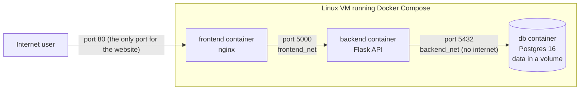

# FormFlow architecture

This is the diagram I drew for section 2.1 of the Phase 0 design worksheet. Each arrow points from the part that sends a request to the part that receives it, and the label on the arrow says which port is used and which network carries the request.

## How to read it

Here is what the diagram shows, one point at a time.

- Of the three containers, only the frontend publishes a port, and that port is 80, which is the port people use to open the website. The backend and the db have no port that anyone on the internet can reach. The VM also keeps port 22 open so that the pipeline can log in with an SSH key and deploy, but that port is not part of the app, and I explain why it is open in the notes at the end of the worksheet.
- I made a network called frontend_net. It connects the frontend and the backend, so the frontend can pass the requests it receives on to the backend. That is the only job this network does.
- I made a second network called backend_net. It connects the backend and the db, so the backend can save and read the form entries. I marked this network as internal, which means Docker gives it no connection to the internet at all.
- The frontend and the db are never on the same network, so they cannot talk to each other. A request has to go through the backend before it can reach the db.
- The form entries are stored in a volume called db_data. A volume is a storage space that lives outside the container, so if I delete and recreate the db container, for example during a deploy or a rollback, the data is still there.
