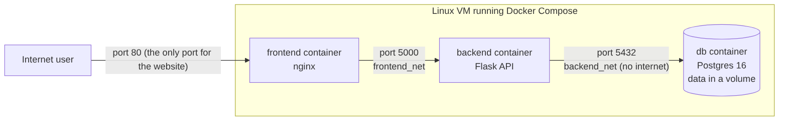

# Phase 0 Design Worksheet: FormFlow

Project: Dockerized 3-Tier App with Full CI/CD
Group: 5
Tools: Docker, Docker Compose, Docker Hub, GitHub Actions and a Linux VM on Azure

## 1. What the brief is asking for

The founder wants new features shipped nonstop until the investor demo. The founder also wants to always know which version is running, a quick way back if a deploy breaks, and no money spent on a second staging server. These look like they fight each other, because shipping fast usually means checking less.

My idea is to ship often, but make every release small, labelled, tested and easy to undo. This is how I cover each wish:

| The brief wants | What I do about it |
|---|---|
| Ship often | A push to the main branch starts the whole pipeline by itself, so nobody copies files by hand. |
| Know what is running | Every image has a tag that never changes, and the running app tells me its own tag. |
| A fast way back | Old images stay on Docker Hub, so going back needs no rebuild. |
| No paid staging | The pipeline starts a throwaway copy of the whole app inside the free GitHub runner and tests it before anything reaches the VM. |

## 2.1 Tier boundaries



The picture above is a copy of the diagram in architecture.md in the same folder, which also has a short note on how to read it.

I split the app into three containers and each one has one job.

| Container | What is inside | Who can reach it | Why it is separate |
|---|---|---|---|
| frontend | nginx, the web page, and a rule that passes /api/ calls on to the backend | The internet, on port 80 only | It is the only public entry point. It is small and it is the part I change most. |
| backend | The Flask API. It checks the input and it is the only code that talks to the database | Only the frontend, over frontend_net | It holds the database login, so it should never face the internet. |
| db | Postgres 16 and a volume called db_data | Only the backend, over backend_net | It holds the data. It has no route to or from the internet. |

Why I did not put everything in one container:

1. I can change one part without touching the others. If I only change the page text, only the frontend image is rebuilt.
2. It is safer. The frontend and the db are not on the same network, so if someone breaks into the frontend they still cannot reach the data directly.
3. Each part uses its own official image (nginx, Python, Postgres), so each can be updated on its own.
4. Containers can be deleted and made again, but data cannot. The data sits in the db_data volume, so a deploy or a rollback never wipes it.
5. If I ever need to, I can put one tier back to an older version without touching the others.

Networks:

- I made a network called frontend_net. It connects the frontend and the backend, so the frontend can pass the requests it receives on to the backend.
- I made a second network called backend_net. It connects the backend and the db, so the backend can save and read the form entries. I marked it internal, which means Docker gives it no connection to the internet in either direction.
- The backend is on both networks, but the frontend and the db do not share any network, so they cannot talk to each other. A request has to go through the backend to reach the data.
- Of the three containers, only the frontend publishes a port, and it is only port 80. This is why the public address is just http://VM-IP with nothing after it.

## 2.2 Versioning and tagging strategy

### Tag format

```
<dockerhub-user>/formflow-frontend:sha-a1b2c3d
<dockerhub-user>/formflow-backend:sha-a1b2c3d
```

The tag is "sha", a dash, then the first 7 characters of the Git commit ID. The commit ID comes from the exact code, so one tag always points to one version of the code.

My rules:

- One commit gives one tag, used on both images, so the frontend and backend versions always match.
- I never push the same tag twice. Once sha-a1b2c3d exists I never overwrite it.
- I never push or deploy the tag latest. If a server is told to run latest, nobody can say which version it is really running.
- The tag is put inside each image when it is built. The backend returns it at /api/version and the frontend writes it to /version.txt.

### How I can tell what is live

1. In the browser, the footer of the site shows the frontend version and the backend version.
2. With one command: `curl http://VM-IP/api/version`
3. On the server: `docker ps --format 'table {{.Names}}\t{{.Image}}'` shows the image names with their tags.
4. In the deploy log: `/opt/formflow/deploy-history.log` has one line for every deploy or rollback, with the time, the tag and the pipeline run that did it.

### How a release flows (no staging server)

1. A developer pushes to the main branch.
2. The pipeline builds both images in the GitHub runner and tags them sha-xxxxxxx.
3. It starts the whole app inside the runner as a throwaway copy and runs smoke tests. /api/health must return 200, and a form entry must be saved and read back. This copy is my staging and it costs nothing.
4. Only if the tests pass are the images pushed to Docker Hub.
5. The pipeline connects to the VM over SSH. It saves the current tag as previous_tag, writes the new tag into the server's .env file, then runs `docker compose pull` and `docker compose up -d`.
6. It checks http://VM-IP/api/health and checks that /api/version shows the new tag. It keeps trying for about 60 seconds.
7. If the check fails, the VM goes back to previous_tag by itself, and the pipeline run is marked as failed so I can see it.

### Rollback procedure, step by step

Rollback is fast because the old images are still on Docker Hub, so nothing has to be rebuilt, and the database volume is not touched.

1. Find the last good tag. It is in `/opt/formflow/previous_tag` and in deploy-history.log.
2. Run the rollback. Either start the Rollback workflow in GitHub Actions and type the tag, or log in to the VM and run `/opt/formflow/rollback.sh sha-xxxxxxx`.
3. The script writes that tag into .env, then runs `docker compose pull` and `docker compose up -d`.
4. Check it. `curl http://VM-IP/api/version` should show the old tag and `curl http://VM-IP/api/health` should return 200.
5. The script adds a ROLLBACK line to deploy-history.log.

Automatic or manual:

- Automatic: the health check in step 6 of the release flow fails, so the VM rolls back by itself.
- Manual: a person sees something the health check cannot see, for example a wrong label on a button, and starts the Rollback workflow.

### The database rule that keeps rollback safe

Database changes may only add things, like a new table or column. They must never rename or delete something the older code still uses. Right now the app only runs CREATE TABLE IF NOT EXISTS. If I broke this rule, an old version could crash against a newer database. So a destructive change needs its own planned migration and cannot go out as a normal release.

## 2.3 Secrets handling plan

| Secret | Used by | On a developer machine | In GitHub (pipeline) | On the VM |
|---|---|---|---|---|
| DB_PASSWORD | db and backend | `.env` file, ignored by git | Actions secret DB_PASSWORD | `/opt/formflow/.env`, permissions 600, written by the pipeline at deploy time |
| DOCKERHUB_TOKEN (an access token, not the account password) | Pipeline, to push images | Not needed | Actions secret DOCKERHUB_TOKEN | Not stored. The images are public and have no secrets in them, so the VM pulls without logging in |
| DOCKERHUB_USERNAME | Naming the images | `.env` file | Actions secret DOCKERHUB_USERNAME | In `.env` as DOCKERHUB_USER |
| VM_SSH_PRIVATE_KEY (a key made only for deployments) | Pipeline, to log in to the VM | Not needed | Actions secret VM_SSH_PRIVATE_KEY | The matching public half is in authorized_keys |
| VM_HOST and VM_USER | Pipeline, to find the VM | Not needed | Actions secrets VM_HOST and VM_USER | Not applicable |

Settings that are not secret (DB_NAME, DB_USER, HTTP_PORT) are also in `.env`, so there is one place to change them.

None of these secrets is hardcoded in any Dockerfile, in docker-compose.yml, in the application code or in the workflow files, and none is committed to the repository. The repository only has `.env.example`, which has placeholder words. The real `.env` is listed in `.gitignore`. docker-compose.yml refuses to start if a needed value is missing, so a forgotten secret fails loudly and is never replaced by a quiet default.

If a secret is ever committed by mistake, deleting it from the file is not enough. I would have to change it straight away, because it stays visible in the repository history.

## Notes where the build differs from this worksheet

1. The first push to Docker Hub (sha-c43eb34) was done by hand, because the brief asks for it before the pipeline exists, and since then only the pipeline pushes images.
2. The VM runs docker-compose.prod.yml, which only pulls images, because the VM has no source code to build from and that is normal for a server.
3. deploy.sh (and so rollback.sh) pulls the images before it writes the new tag into .env, so a tag missing from Docker Hub changes nothing on the server, which only makes release step 5 and rollback step 3 safer.
4. The pipeline does not rewrite .env on every deploy. It only writes one if none exists and otherwise checks that the DB_PASSWORD secret matches, because Postgres keeps the password it first started with and a changed one would lock the backend out of its own database.
5. I added a 7th secret, VM_HOST_FINGERPRINT, so the pipeline can check it is talking to my real VM, which is safer than switching host key checking off.
6. Port 22 (SSH) is open next to port 80, with key login only, because the GitHub runner has no fixed IP address that I could allow.
7. The VM is in West US 3 and is a Standard_D2ads_v6, because my new Azure subscription had no quota for the cheaper sizes in the other regions I tried, and this does not change the design.
